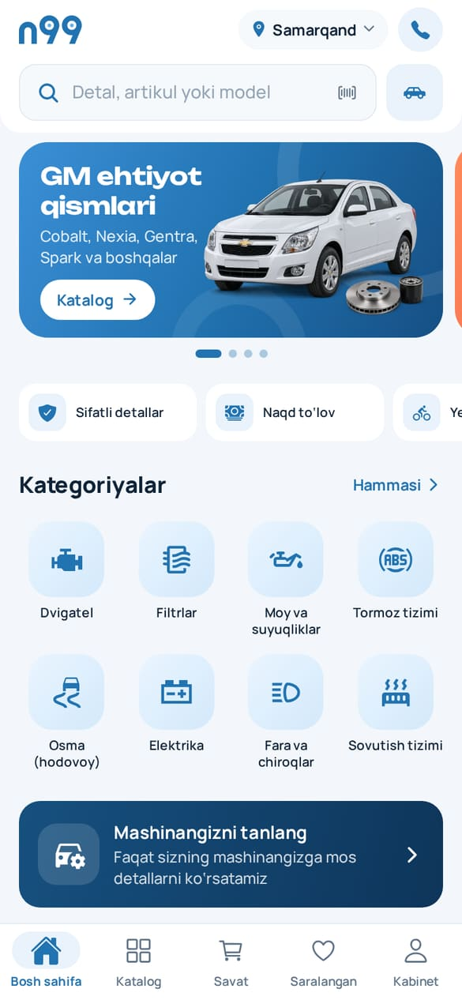
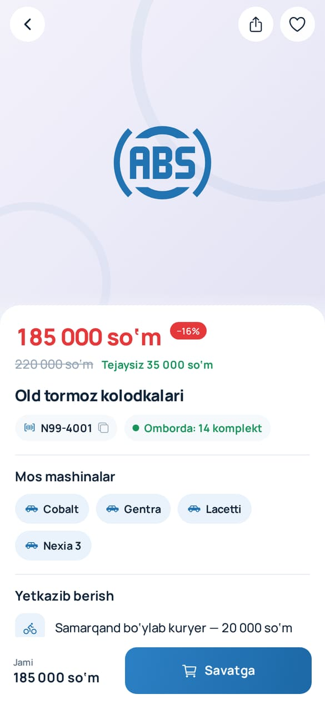
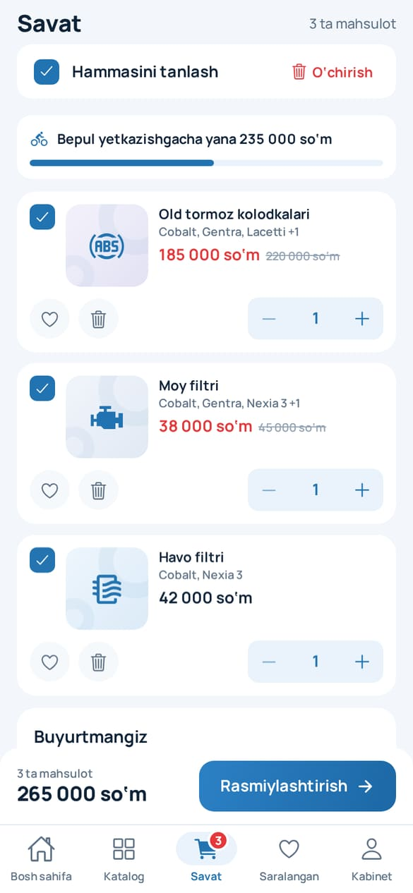
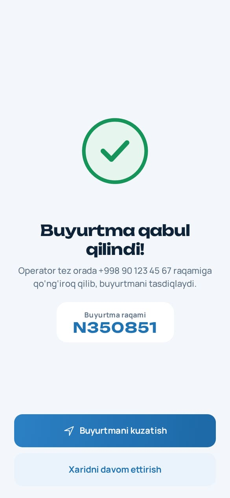

# OPTOVIK N99 — avto ehtiyot qismlar do‘koni

Android va iPhone uchun mustaqil ilova (Telegram shart emas). GM / Chevrolet ehtiyot qismlari va avtoaksessuarlar: katalog, savat, naqd to‘lovli buyurtma, buyurtmani kuzatish va do‘kon egasi uchun boshqaruv paneli. Uzum Market uslubidagi oq-ko‘k dizayn, `n99` logotipi, o‘zbek va rus tillari.

**Ishga tushirish (do‘kon egasi uchun):** [QOLLANMA.md](QOLLANMA.md) · **Dizayn:** [docs/DESIGN.md](docs/DESIGN.md) · **Tekshirish:** [TESTING.md](TESTING.md)

<p>
   
</p>

## Imkoniyatlar

**Mijoz**
- Bosh sahifa: o‘zi aylanadigan bannerlar, kategoriyalar, «Mening mashinam» bo‘yicha tavsiyalar, aksiyalar, ommabop va yangi tovarlar, GM modellari, barcha tovarlar.
- Qidiruv: nom, artikul (bo‘shliq va chiziqsiz), model; lotin va kirill (`кобальт колодка` → Cobalt kolodkalari), bitta harf xatosi, oxirgi qidiruvlar.
- Katalog: ehtiyot qismlar / aksessuarlar, kategoriya va model bo‘yicha; saralash, «faqat mavjud», aksiya, model, narx oralig‘i filtrlari.
- Tovar sahifasi: rasm galereyasi, chegirma va tejov, qoldiq, mos mashinalar (sizning mashinangizga mosligi), yetkazish shartlari, tavsif, o‘xshash tovarlar, artikulni nusxalash, ulashish.
- Savat: tanlab buyurtma berish, miqdor, o‘chirib «Qaytarish», bepul yetkazishgacha qolgan summa, qoldiq o‘zgarsa avtomatik moslash.
- Rasmiylashtirish: do‘kondan olib ketish yoki kuryer, +998 telefon niqobi, naqd to‘lov (Payme / Click / Uzum Bank — «Tez orada»), izoh.
- Buyurtmalar: holat chizig‘i (Qabul qilindi → Tasdiqlandi → Yo‘lda/Tayyor → Yetkazildi), jonli yangilanadi; tasdiqlanmagan buyurtmani bekor qilish, qayta buyurtma.
- Kabinet: ism va telefon, mashina, til (UZ/RU), aloqa (qo‘ng‘iroq, Telegram, Instagram, Yandex/Google xarita), yetkazish va to‘lov, savol-javob, maxfiylik siyosati.

**Do‘kon egasi (Kabinet → «Do‘kon egasi uchun»)**
- Bugungi buyurtmalar va savdo, yangi buyurtma kelsa xabar.
- Buyurtmalar: holatni o‘zgartirish, mijozga qo‘ng‘iroq, ichki izoh. Tasdiqlanganda qoldiq avtomatik ayriladi, bekor qilinsa qaytariladi.
- Tovarlar: qo‘shish/tahrirlash/o‘chirish, narx, eski narx (aksiya), qoldiq, artikul, mos modellar, rasmlar (havola yoki telefondan Cloudinary orqali).
- Bannerlar (o‘zbekcha/ruscha, rang, havola) va do‘kon sozlamalari (telefonlar, manzil, xarita, yetkazish narxi, bepul yetkazish chegarasi, MCHJ nomi va STIR).

## Texnologiya

- Expo SDK 58, React Native 0.88, Expo Router, Reanimated 4 (animatsiyalar), expo-image, Manrope + Unbounded shriftlari. Hammasi **Expo Go**’da ishlaydi.
- Firebase Realtime Database + Firebase Auth (mijoz — anonim, admin — email/parol). **Server shart emas, bepul (Spark) tarifda ishlaydi.**
- Xavfsizlik `database.rules.json` da: narx katalogdagidan farq qilsa, miqdor qoldiqdan oshsa, vaqt soxta bo‘lsa yoki 30 soniyada ikkinchi buyurtma bo‘lsa — server rad etadi. Mijoz faqat o‘z buyurtmasini ko‘radi; tovar, banner, sozlamani faqat admin o‘zgartiradi.

```
src/app/          Expo Router sahifalari (yupqa fayllar)
src/screens/      ekranlar (admin/ — boshqaruv)
src/components/   ui/ (tugma, maydon, varaq…), shop/ (karta, banner, buyurtma…), brand/ (logotip, intro)
src/domain/       sof mantiq: katalog, qidiruv, savat, buyurtma, telefon, pul (testlangan)
src/state/        katalog, savat, sozlamalar, hisob, buyurtmalar (Firebase bilan)
src/i18n/         uz.ts va ru.ts
database.rules.json, seed/katalog.json, scripts/firebase-setup.mjs
```

## Buyruqlar

```sh
npm ci
npx expo start            # telefon va kompyuter bir tarmoqda; Expo Go bilan QR
npm run typecheck && npm run lint && npm test
npm run test:rules        # xavfsizlik qoidalari (Java 21 kerak)
```

## Keyingi bosqichlar

Payme / Click / Uzum Bank, SMS orqali kirish, push-xabarlar va do‘konlarga chiqarish rejasi — [QOLLANMA.md](QOLLANMA.md#keyingi-qadamlar).
