# N99 dizayn tizimi

Oq + to‘q ko‘k. Uzum Market tuzilishi (pastki 5 bo‘lim, katta qidiruv, bannerlar, 2 ustunli kartalar), lekin avto ehtiyot qismlar uchun: mashina modeli, artikul, moslik.

## Logotip

`n99` — maxsus chizilgan so‘z-belgi (shriftdan olinmagan): «n» — yo‘l arkasi, ikki «9» — ichida yorug‘ gupchagi bor g‘ildiraklar, ostida yo‘l chizig‘i. Geometriya: `src/components/brand/geometry.ts`; ikonkalar generatori: `scripts/brand.mjs` (`npm i --no-save @resvg/resvg-js && node scripts/brand.mjs`).

| Fayl | Nima |
| --- | --- |
| `assets/icon.png` | iOS/umumiy ikonka, 1024 |
| `assets/android-icon-*.png` | Android adaptive (oldingi qatlam, fon, monoxrom) |
| `assets/splash-icon.png` | ochilish ekrani (ko‘k fonda oq logotip) |
| `assets/brand/*.svg` | vektor: ikonka, so‘z-belgi (ko‘k va oq) |

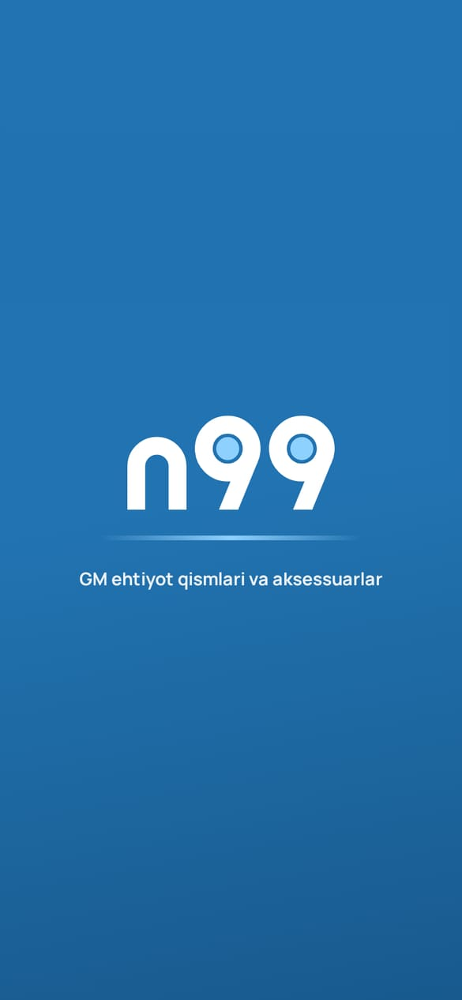

## Ranglar

Asosiy ko‘k Avto A1 Sky Glass `#2F8FD8` dan **20% to‘qroq**: `#2173B1`. Matn oq tugmada o‘qiladi (kontrast 5:1).

| Token | Rang | Qayerda |
| --- | --- | --- |
| `primary` | `#2173B1` | tugmalar, faol belgilar, logotip |
| `primaryDark` | `#185A8E` | gradient oxiri, bosilgan holat |
| `sky` | `#8ED1FF` | gupchaklar, ko‘k fondagi urg‘u |
| `tint` | `#EAF3FB` | yumshoq fon: chip, ikonka qutisi, miqdor tanlagich |
| `bg` | `#F3F7FB` | ekran foni |
| `ink` / `muted` | `#0F2338` / `#5D7186` | asosiy va ikkinchi darajali matn |
| `sale` | `#E5383B` | aksiya narxi va «−N%» |
| `success` / `warning` | `#17945A` / `#D9822B` | mavjud, tejov / kam qoldi |

Barcha qiymatlar: `src/theme/tokens.ts`. Ekranlarda rang kodi yozilmaydi — faqat tokenlar.

## Shriftlar

- **Manrope** (400–800) — butun interfeys, narxlar (`fontVariant: tabular-nums`).
- **Unbounded** (700/800) — banner sarlavhalari, buyurtma raqami, katta raqamlar.
- Matn o‘lchamlari: `type` (hero, title, h2, h3, body, small, tiny, price, label). Katta shriftga ruxsat — `maxFontSizeMultiplier` 1.35.

## Komponentlar

`src/components/ui`: `Txt`, `Button` (primary — gradient, secondary, outline, ghost, danger), `IconButton`, `PressableScale` (barcha bosiladigan joylar), `Field` / `PhoneField` (+998 doim turadi), `Stepper`, `Sheet` (pastdan chiqadigan oyna), `Segmented`, `Chip`, `Checkbox`, `Radio`, `ListRow`, `SwitchRow`, `Pill`, `Card`, `Skeleton`, `EmptyState`, `Header`, `ToastHost`.

`src/components/shop`: `ProductCard`, `ProductRail`, `ProductImage` (rasm bo‘lmasa kategoriya belgisi), `AddToCart`, `FavButton`, `BannerCarousel`, `CategoryGrid`, `ModelRail`, `SearchPill`, `OrderTimeline`, `OrderCard`, `StatusPill`.

## Animatsiyalar (Reanimated 4)

| Joy | Animatsiya |
| --- | --- |
| Ochilish | g‘ildirak ustidan yorug‘lik aylanadi, gupchaklar «yonadi», yo‘l chizig‘i yoyiladi, ekran yumshoq ochiladi |
| Har bir tugma | bosilganda 0.96 ga kichrayib, prujina bilan qaytadi; muhim amallarda tebranish (haptics) |
| Pastki menyu | tanlangan bo‘lim ostida kapsula suriladi, ikonka sakraydi, savat soni o‘sganda «pop» |
| Bosh sahifa | logotip qatori yig‘iladi, qidiruv tepada qoladi; bannerlar parallaks va cho‘ziladigan nuqtalar |
| Kartalar | ro‘yxatda navbat bilan pastdan chiqadi; «Savatga» → miqdor tanlagichga aylanadi; raqam yuqoriga «sakraydi» |
| Yurakcha | sakraydi va atrofga uchqunlar sochiladi |
| Tovar sahifasi | galereya tortilganda kattalashadi, pastga surilganda tepada sarlavha chiqadi |
| Savat | o‘chirilgan qator yo‘qoladi, qolganlari silliq joylashadi; bepul yetkazish chizig‘i to‘ladi |
| Muvaffaqiyat | yashil doira va belgi chiziladi, konfetti |
| Buyurtma holati | chiziq bosqichma-bosqich bo‘yaladi, joriy bosqich «nafas oladi» |
| Yuklanish / bo‘sh holat | skeletlar ustidan yorug‘lik o‘tadi; bo‘sh holat ikonkasi sekin suzadi |

Uzun ro‘yxatlarda faqat birinchi 6–8 element animatsiya bilan chiqadi — tezlik uchun.

## Qoidalar

- Har yangi matn `src/i18n/uz.ts` va `ru.ts` ga birga qo‘shiladi (test tekshiradi).
- Narx, qoldiq, rasm faqat bazadan. Namuna tovarlar faqat `seed/katalog.json` da va bo‘sh bazaga yuklanadi.
- Bosiladigan maydon kamida 44×44, har bir tugmada `accessibilityLabel`.
- Planshetda 3–4 ustun, kontent kengligi 760 dan oshmaydi.

## Ekranlar

| | | |
| --- | --- | --- |
| 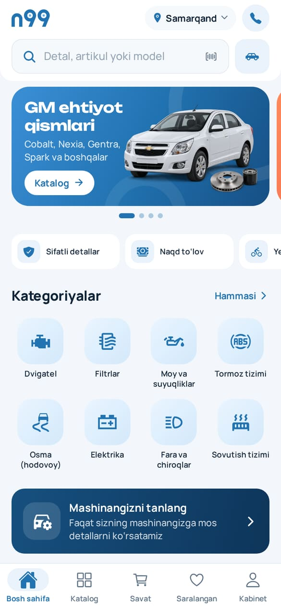 Bosh sahifa | 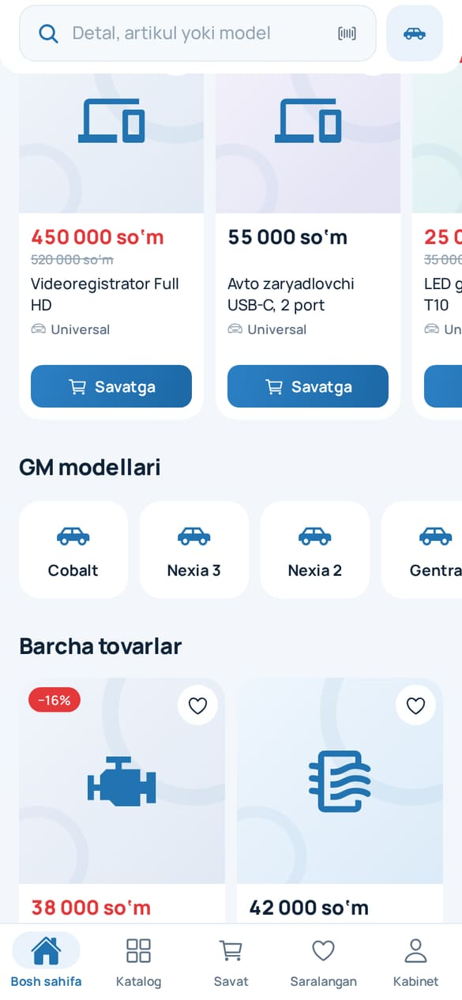 Aksiyalar, modellar | 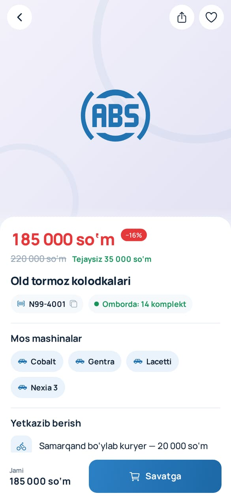 Tovar |
| 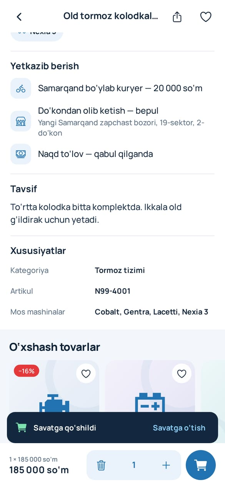 Savatga qo‘shildi | 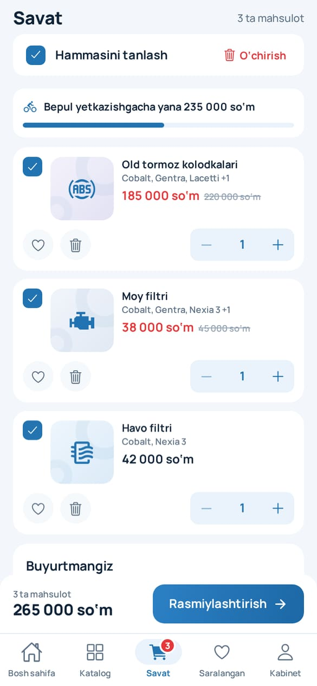 Savat | 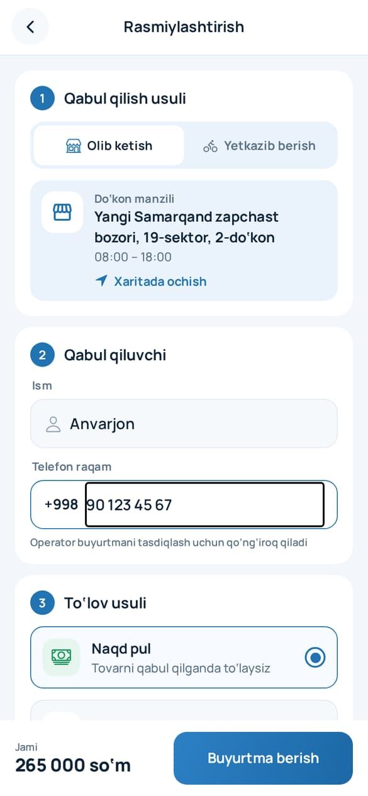 Rasmiylashtirish |
| 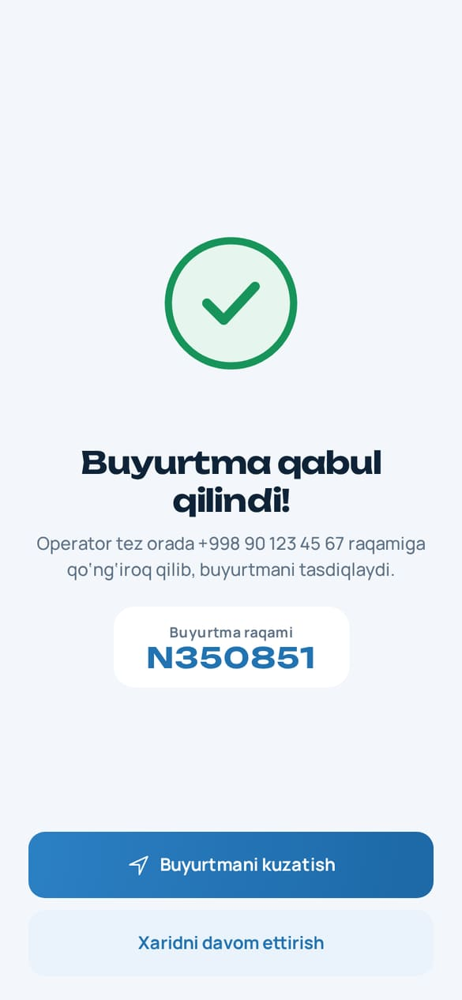 Buyurtma qabul qilindi | 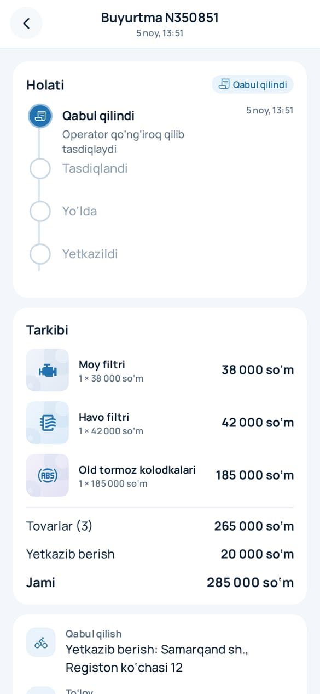 Buyurtma holati | 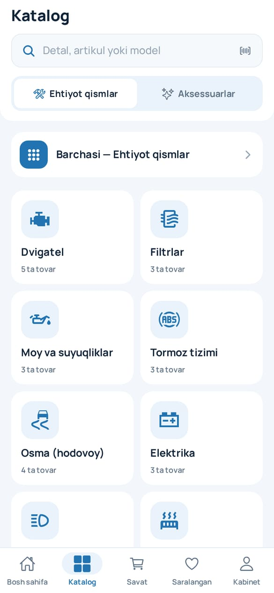 Katalog |
| 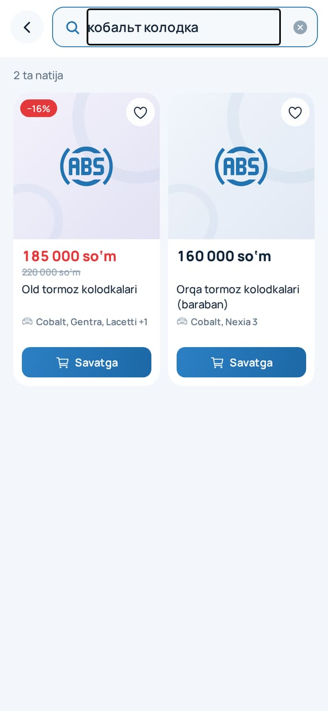 Kirillcha qidiruv | 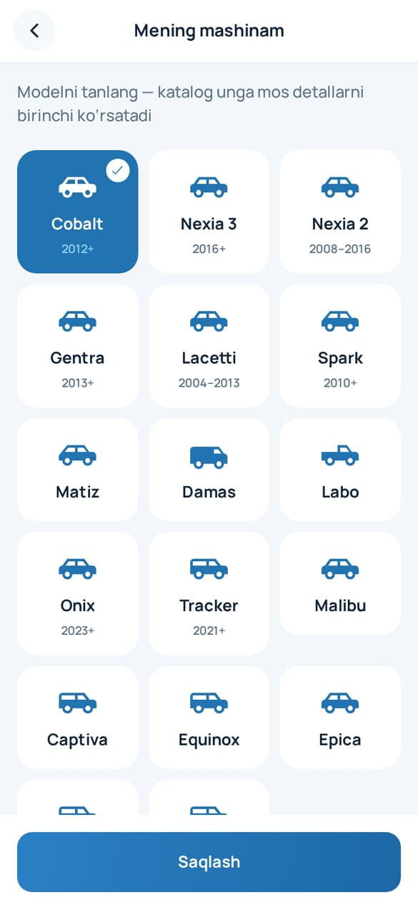 Mening mashinam | 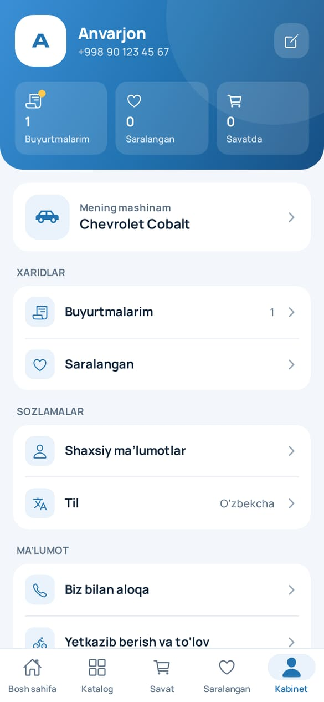 Kabinet |
| 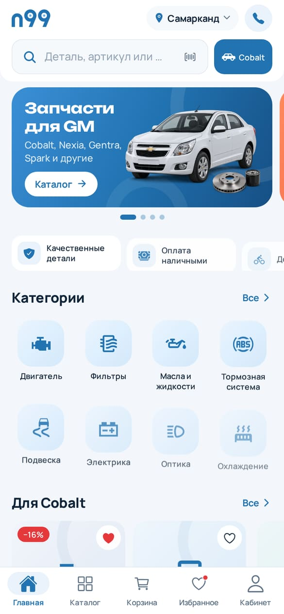 Ruscha | 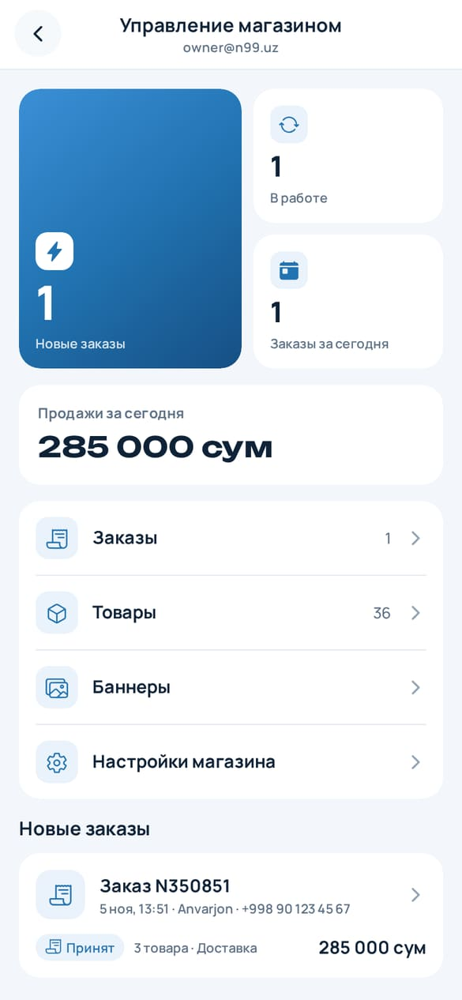 Admin panel | 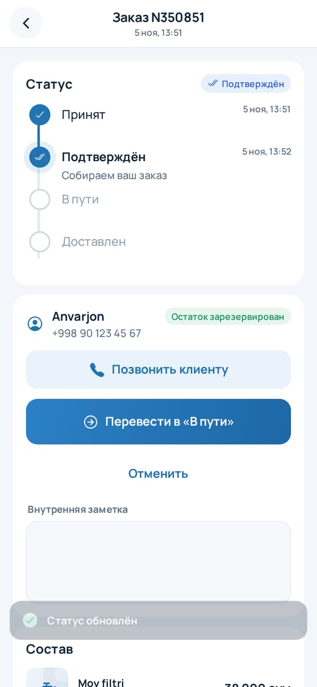 Admin: buyurtma |

Skrinshotlar web versiyada, Firebase emulyatori va namuna katalog bilan olingan (390×844).
